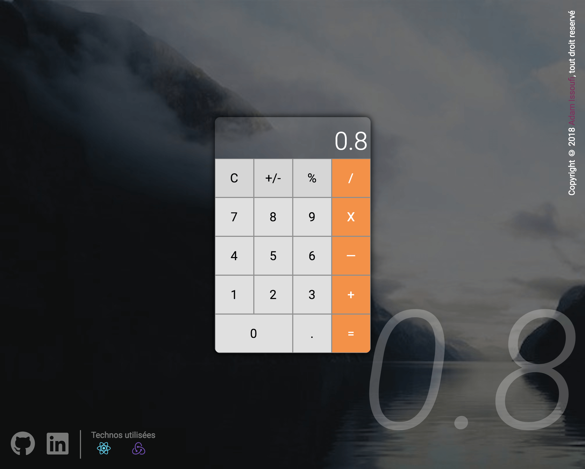
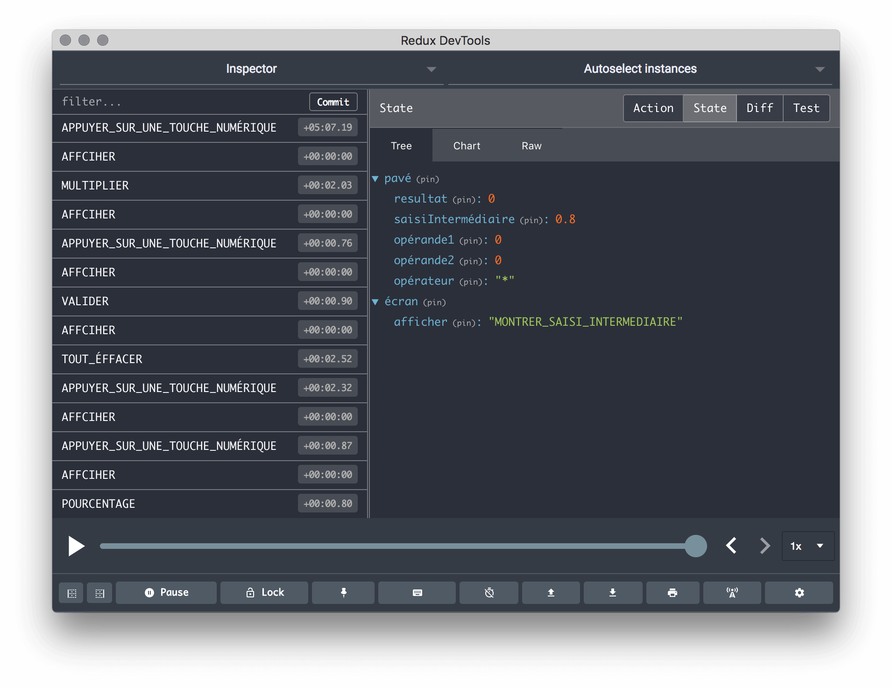
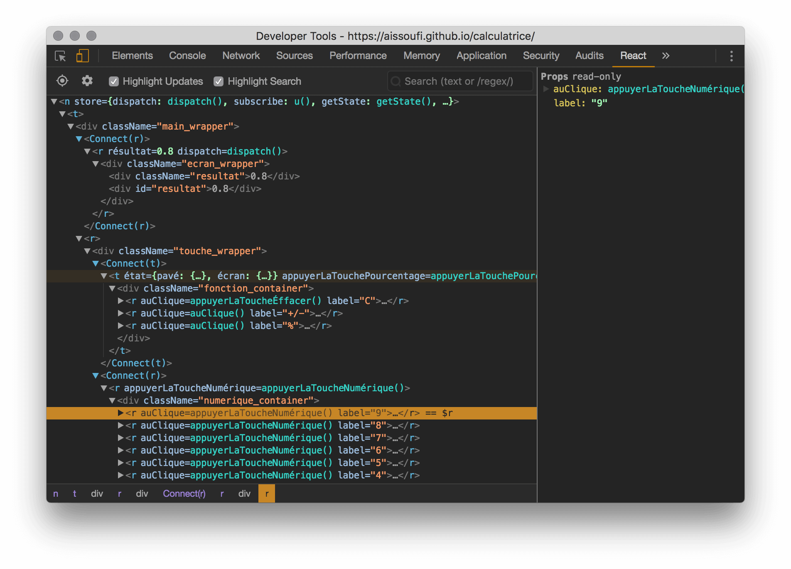

# Calculatrice
<p align="center">
  
</p>

## [Démo](https://calculator.issoufi.fr)

## Lancer le projet
```
npm start
```

## How it computes

The calculator works like a basic pocket calculator: it evaluates from left to right, so `2 + 3 × 4 =` gives `20`.

- An operator applies the previous one and shows the running total; two operators in a row keep the last one.
- `=` shows the result: an operator continues from it, a digit starts a new calculation.
- `C` clears the number being typed, then the key turns into `AC`, which resets everything.
- Results are rounded to 12 significant digits, and a division by zero shows `Erreur`.

The logic lives in a pure, framework-free engine, [`src/features/calculator/engine.js`](src/features/calculator/engine.js): each key press is a function from one state to the next. The Redux slice next to it only hands the key presses to the engine.

## Tests

Use the Node.js version pinned in `.nvmrc` (`nvm use` selects it), then:

```bash
npm ci                        # install the dependencies from package-lock.json, and the git hooks
npm test                      # watch mode: re-runs the tests of the changed files
npm test -- --watchAll=false  # a single run of every test, as in the CI
```

Tests sit next to the code they cover and are named `*.spec.js` or `*.spec.jsx`. `npm test` first runs the tests of the commit tooling once, `scripts/**/*.spec.mjs`, with the Node.js test runner.

The [CI workflow](.github/workflows/ci.yml) runs on every pull request and every push to `master`:

1. it installs the dependencies with `npm ci`;
2. it runs the tests once;
3. it builds the app.

A failing test or build fails the check. On a pull request, a second job checks the commit messages and the title (see [Commit messages](#commit-messages)).

## Commit messages

Every commit follows [Conventional Commits](https://www.conventionalcommits.org/) and names its ticket with a `Refs: CALC-<n>` git trailer, in the last paragraph of the message, next to `Co-Authored-By`:

```text
feat: add a percent key

Refs: CALC-17
Co-Authored-By: Jane Doe <jane@example.com>
```

- `npm ci` installs two [husky](https://typicode.github.io/husky/) hooks. `commit-msg` runs [commitlint](https://commitlint.js.org/), which refuses a message without a conventional header or a valid `Refs:` trailer. On a `CALC-<n>` branch, `prepare-commit-msg` adds `Refs: CALC-<n>` when the message has no `Refs:` trailer.
- On every pull request, the CI checks each commit, and checks that the title is a conventional header.
- Write a breaking change as a `BREAKING-CHANGE:` trailer, with a dash, or in a paragraph of its own above the trailers: git does not read `BREAKING CHANGE:` as a trailer, since its key has a space, so a `Refs:` line in the same paragraph is usually not found.
- Merge commits, reverts and the commits of release-please and Dependabot are ignored. The rule applies from now on: older commits are not rewritten.

The rules live in [`commitlint.config.mjs`](commitlint.config.mjs) and [`scripts/commits/`](scripts/commits/).

## Deployment

[Cloudflare Pages](https://pages.cloudflare.com/) builds and hosts the app at https://calculator.issoufi.fr:

- every push to `master` deploys the production site;
- every other branch, pull requests included, gets a preview deployment with its own URL.

The Cloudflare Pages project uses these build settings, and needs no environment variable:

| Setting                | Value                                 |
| ---------------------- | ------------------------------------- |
| Build command          | `npm run build`                       |
| Build output directory | `build`                               |
| Node.js version        | read from `.nvmrc` by the build image |

Two files make the build fit Cloudflare Pages:

- `package.json` sets `homepage` to `.`: the built `index.html` loads its assets with relative paths, so the app works from the root of any domain, previews included.
- [`public/_headers`](public/_headers) is copied into `build/` and sets the cache headers:
  - the hashed files under `/static/` are cached for a year;
  - the page is revalidated on every visit, so a new deployment shows at once.

## Technos utilisées
* [ReactJS](http://redux.js.org)
* [ReduxJS](http://redux.js.org)

## Autres captures d'écran
<p align="center">


</p>