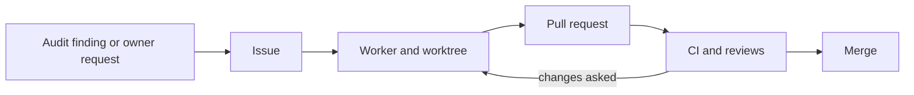

# Ticket lifecycle

1. **Issue.** The master writes every issue in the same shape: context, problem with evidence, proposed solution and acceptance criteria. [#8](https://github.com/AIssoufi/calculator/issues/8) starts from measurements of an audit; [#4](https://github.com/AIssoufi/calculator/issues/4) from a build tool that is no longer maintained, Create React App. The repository's autolink turns `CALC-<n>` into a link to issue `#<n>`.
2. **Worker.** The master picks the next ticket by priority, creates the `CALC-<n>` branch from `master` in its own worktree, and starts a worker there with a short brief: what other workers touch at the same time, useful examples, what to avoid.
3. **Commits.** The worker makes small [Conventional Commits](https://www.conventionalcommits.org/), each with a `Refs: CALC-<n>` trailer, enforced since [#19](https://github.com/AIssoufi/calculator/pull/19) (see [Commit messages](../../README.md#commit-messages)).
4. **Pull request.** Its title is a conventional header and its body holds a summary, a test plan with measured figures, the review verdict and `Closes #<n>`, as in [#23](https://github.com/AIssoufi/calculator/pull/23).
5. **Checks.** The CI and the Cloudflare Pages preview run on the pull request; the worker fixes what fails, rebases on `master` when it moves, and reports to the master.
6. **Merge.** The master reads the pull request, relays the owner's feedback if any, and merges it with a merge commit, which closes the issue.

Work outside the ticket goes the other way: the worker reports it, and the master turns it into a new issue, such as [#22](https://github.com/AIssoufi/calculator/issues/22), found during [#23](https://github.com/AIssoufi/calculator/pull/23).
